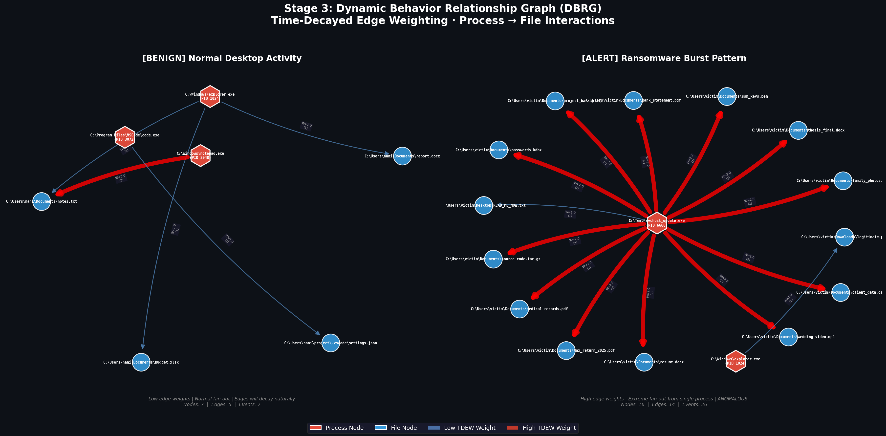

# 🛡️ Real-Time Non-Destructive Ransomware Defense System


-brightgreen?style=for-the-badge&logo=pytest)
-brightgreen?style=for-the-badge&logo=pytest)
-brightgreen?style=for-the-badge&logo=pytest)
-brightgreen?style=for-the-badge&logo=pytest)
-brightgreen?style=for-the-badge&logo=pytest)
-brightgreen?style=for-the-badge&logo=pytest)


> **A Machine Learning & OS-Kernel Level Defense Pipeline for Real-Time Ransomware Interception, Behavioral Threat Modeling, and Zero-Data-Loss Rollback.**

---

## 📌 Executive Overview

The **AI Ransomware Defense System** is a 12-stage enterprise security solution designed to observe low-level operating system events, model behavioral relationships using exponential time-decay dynamics, score threat intent via multi-signal corroborated machine learning, and enforce kernel-level isolation with zero-data-loss write-ahead journaling rollback capabilities.

> [!NOTE]
> **Design Principle — Non-Destructive by Default:**  
> Unlike traditional antivirus software that abruptly terminates processes or causes data loss, this system observes, models, and scores behavior continuously without altering execution until a quantified, multi-signal risk threshold is crossed.

---

## 🏗️ End-to-End System Architecture Roadmap

The pipeline is organized into **11 sequential execution stages** plus a **12th evaluation phase**:

```text
 ┌───────────────────────────────────────────────────────────────────────────────────┐
 │                            STAGE 1: TELEMETRY COLLECTION                          │  <-- COMPLETED & VERIFIED (20/20)
 │                Asynchronous File I/O Interception, Process Provenance             │
 └─────────────────────────────────────────┬─────────────────────────────────────────┘
                                           │ (eCAR JSON Telemetry Stream in SQLite)
                                           ▼
 ┌───────────────────────────────────────────────────────────────────────────────────┐
 │                      STAGE 2: PROCESS IDENTIFICATION & LINEAGE                    │  <-- COMPLETED & VERIFIED (14/14)
 │                 Provenance Tracing & Parent-Child Lineage Rarity (S_rel)          │
 └─────────────────────────────────────────┬─────────────────────────────────────────┘
                                           │ (Context-Enriched eCAR Events)
                                           ▼
 ┌───────────────────────────────────────────────────────────────────────────────────┐
 │                STAGE 3: DYNAMIC BEHAVIOR RELATIONSHIP GRAPH (DBRG)                │  <-- COMPLETED & VERIFIED (28/28)
 │                  Exponential Time-Decayed Edge Weighting (TDEW Engine)            │
 └─────────────────────────────────────────┬─────────────────────────────────────────┘
                                           │ (Live Process->File Directed Graph)
                                           ▼
 ┌───────────────────────────────────────────────────────────────────────────────────┐
 │            STAGE 4: MULTI-LAYER FEATURE EXTRACTION & HAWKES PROCESS               │  <-- COMPLETED & VERIFIED (62/62)
 │         4KB Buffer Sampling, Shannon Entropy, ETD, Hawkes Point Process           │
 └─────────────────────────────────────────┬─────────────────────────────────────────┘
                                           │ (Feature Vector: S_entropy, S_ETD, S_dist, S_dev, S_stab, λ_norm)
                                           ▼
 ┌───────────────────────────────────────────────────────────────────────────────────┐
 │                 STAGE 5: ANOMALY SCORING & BENIGN PROFILING (DAC-OCF)             │  <-- COMPLETED & VERIFIED (30/30)
 │              Dual Isolation Forest + One-Class SVM, Calibrated Threat Fusion      │
 └─────────────────────────────────────────┬─────────────────────────────────────────┘
                                           │ (Anomaly Scores: S_IF, S_OCSVM, S_anomaly, Risk Tiers)
                                           ▼                     ┌── (S_rel from Stage 2 +
 ┌───────────────────────────────────────────────────────────────────────────────────┐
 │              STAGE 6: MULTI-SIGNAL CORROBORATION & SIGMOIDAL ACCELERATION         │  <-- COMPLETED & VERIFIED (26/26)
 │  Causality Fusion (S_entropy/S_dist/S_dev/S_rel/S_stab) -> IntentDrift + Velocity  │
 │  Independent of Stage 5's trained model - consumes Stage 2 + Stage 4 signals only  │
 └─────────────────────────────────────────┬─────────────────────────────────────────┘
                                           │ (IntentDrift, drift_velocity)
                                           ▼
 ┌───────────────────────────────────────────────────────────────────────────────────┐
 │              STAGE 7: DYNAMIC TRUST EVOLUTION & RISK STATE ENGINE                 │  <-- UPCOMING NEXT
 │           Momentum Trust Decay, Risk Tiers (SAFE -> MONITOR -> VERIFY -> CRITICAL) │
 └─────────────────────────────────────────┬─────────────────────────────────────────┘
                                           │
                                           ▼
 ┌───────────────────────────────────────────────────────────────────────────────────┐
 │             STAGES 8–10: CONTAINMENT, JOURNALING & ZERO-DATA-LOSS ROLLBACK        │
 │              Synthetic Harness, SIGSTOP Kernel Freeze, Edmonds-Karp Min-Cut      │
 └─────────────────────────────────────────┬─────────────────────────────────────────┘
                                           │
                                           ▼
 ┌───────────────────────────────────────────────────────────────────────────────────┐
 │                  STAGES 11–12: SOC DASHBOARD & ABLATION EVALUATION                │
 │             WebSocket UI, Isolate & Restore / Authorize & Resume Controls         │
 └───────────────────────────────────────────────────────────────────────────────────┘
```

---

## 🚦 Project Implementation Status Matrix

| Stage | Module Name | Primary Role | Status | Hand-off Notes |
|---|---|---|---|---|
| **Stage 1** | **Telemetry Collection** | File I/O Interception, Process Provenance, eCAR Schema, SQLite Store | ✅ **Completed & Verified** | 20/20 Pytest Suite Passed. Streams events to `telemetry.db` |
| **Stage 2** | **Lineage Analysis** | Parent-Child Provenance Tracing & Lineage Rarity ($S_{\text{rel}}$) | ✅ **Completed & Verified** | 14/14 Pytest Suite Passed. Enriches eCAR with lineage context |
| **Stage 3** | **DBRG Graph Engine** | NetworkX Directed Graph with TDEW Exponential Weight Decay | ✅ **Completed & Verified** | 28/28 Pytest Suite Passed. Builds live process-file interaction graph |
| **Stage 4** | **Feature Extraction** | 4KB Buffer Sampling, Shannon Entropy, ETD, Hawkes Point Process | ✅ **Completed & Verified** | 62/62 Pytest Suite Passed. Produces per-event feature vectors |
| **Stage 5** | **Anomaly Scoring (DAC-OCF)** | Dual Isolation Forest + One-Class SVM Fusion, Risk Tier Classification | ✅ **Completed & Verified** | 30/30 Pytest Suite Passed. Fused AUC-ROC=0.64, Models saved to `models/` |
| **Stage 6** | **Threat Fusion** | Multi-Signal Corroboration & Sigmoidal Intent Drift Acceleration | ✅ **Completed & Verified** | 26/26 Pytest Suite Passed. Fuses `S_entropy/S_dist/S_dev/S_rel/S_stab` into `IntentDrift`; independent of Stage 5's model |
| **Stage 7** | **Trust State Engine** | Momentum Trust Decay Engine & Risk Tiers (SAFE/VERIFY/CRITICAL) | 📅 *Upcoming* | Controls transitions between risk states |
| **Stage 8** | **Synthetic Harness** | Sandboxed Attack Simulator | 📅 *Upcoming* | Uses `Code/mock_ransomware.ipynb` for red-team validation |
| **Stage 9** | **Kernel Containment** | SIGSTOP / `NtSuspendProcess` Freeze-Graph Min-Cut Engine | 📅 *Upcoming* | Edmonds-Karp minimum cut capacity optimization |
| **Stage 10** | **Journaling & Rollback**| Write-Ahead Journaling Vault & Zero-Data-Loss Selective Rollback | 📅 *Upcoming* | Block-level file backup vault & restore engine |
| **Stage 11** | **SOC Dashboard** | FastAPI WebSocket Backend & Interactive React Cytoscape UI | 📅 *Upcoming* | Analyst-in-the-loop manual override UI |
| **Stage 12** | **Evaluation Sweep** | Parameter Ablation & Red-Team Defense Preparation | 📅 *Upcoming* | Parameter tuning across $\lambda, \beta, \gamma$ constants |

---

## 🕸️ Stage 3: Dynamic Behavior Relationship Graph (DBRG + TDEW)

Stage 3 translates flat eCAR events into a live, thread-safe directed graph of **Process Nodes $\rightarrow$ File Nodes**.

### Mathematical Foundation: Time-Decayed Edge Weighting (TDEW)

$$\text{Active Event Update: } W(e) = W_{\text{old}} \cdot e^{-\lambda \cdot \Delta t} + 1.0$$

$$\text{Passive Decay Sweep: } W_{\text{passive}} = W_{\text{old}} \cdot e^{-\lambda \cdot \Delta t}$$

* **Burst Acceleration ($\Delta t \approx 0$)**: Rapid modifications accumulate weight ($1.0 \rightarrow 2.0 \rightarrow 3.0 \dots$).
* **Exponential Decay ($\Delta t \gg 0$)**: Idle periods exponentially shrink weight toward zero.
* **Garbage Collection**: Background thread prunes edges where $W < 0.01$ and deletes orphan nodes.

### Visual Graph Output (Benign vs Ransomware Scenario)



```text
 Benign Pattern  : Low process out-degree (1-3 files), gradual TDEW decay.
 Ransomware Burst: High process out-degree (10-1000+ files), synchronous TDEW weight spikes.
```

### Sub-Module Specifications (`src/stage_3_dbrg/`)

1. **`src/stage_3_dbrg/tdew_calculator.py`**: TDEW math engine encapsulating active update and passive decay formulas.
2. **`src/stage_3_dbrg/dbrg_manager.py`**: Thread-safe NetworkX `DiGraph` wrapper with lock protection for concurrent ingestion.
3. **`src/stage_3_dbrg/garbage_collector.py`**: Background daemon thread conducting periodic passive decay sweeps and orphan cleanup.
4. **`src/stage_3_dbrg/visualize_dbrg.py`**: Matplotlib & NetworkX side-by-side graph rendering utility.

---

## 📐 Stage 4: Multi-Layer Feature Extraction & Hawkes Point Process

Stage 4 is the core signal-extraction engine that produces per-event content-level and temporal-level threat features.

### Mathematical Foundations

**Shannon Entropy** (Content Entropy):
$$H = -\sum_{i=0}^{255} P(x_i) \cdot \log_2 P(x_i) \quad \in [0, 8.0]$$

**Entropy-Topology Divergence** (ETD — behavioral drift):
$$S_{\text{ETD}} = D_{KL}\big( P(\Delta H, d_{\text{out}} \mid t) \;\|\; P_{\text{benign}} \big)$$

**Hawkes Self-Exciting Point Process** (temporal burstiness):
$$\lambda(t) = \mu + \sum_{t_i < t} \alpha \cdot e^{-\beta(t - t_i)}$$
$$n = \frac{\alpha}{\beta} \quad \text{(superheated when } n \geq 1.0\text{)}$$

### Per-Event Feature Vector Output

| Signal | Description | Range |
|---|---|---|
| $S_{\text{entropy}}$ | Normalized Shannon entropy of 4KB post-write buffer | [0, 1] |
| $S_{\text{ETD}}$ | Entropy-Topology Divergence (2D KL-divergence) | [0, 1] |
| $S_{\text{dist}}$ | Graph Fan-Out Distance (normalized process out-degree) | [0, 1] |
| $S_{\text{dev}}$ | Trajectory Velocity (rate of new file targets/sec) | [0, 1] |
| $S_{\text{stab}}$ | Operational Stability (repeated vs new interactions) | [0, 1] |
| $\lambda_{\text{norm}}$ | Normalized Hawkes intensity | [0, 1] |
| $n$ | Hawkes branching ratio | [0, ∞) |

### Sub-Module Specifications (`src/stage_4_features/`)

1. **`entropy_calculator.py`**: 4KB buffer reader, Shannon entropy, 256-bin byte-frequency histogram variance/kurtosis.
2. **`hawkes_engine.py`**: Per-process Hawkes self-exciting point process with intensity tracking, branching ratio, superheated detection, and horizon-based memory pruning.
3. **`etd_engine.py`**: Rolling 2D joint histogram engine with pre-built benign baseline and KL-divergence computation.
4. **`feature_extractor.py`**: Main orchestrator querying Stage 3 DBRG for topology metrics and producing complete feature vectors.

---

## 🎯 Stage 5: Anomaly Scoring & Benign Profiling (DAC-OCF)

Stage 5 transforms Stage 4 feature vectors into calibrated anomaly scores using Density-Adaptive One-Class Fusion.

### Mathematical Foundation: DAC-OCF Fusion

$$S_{\text{anomaly}} = w_{IF} \cdot S_{IF} + w_{SVM} \cdot S_{SVM}$$

Where $w_{IF} = 0.6$ and $w_{SVM} = 0.4$.

**Isolation Forest** — Tree-based anomaly isolation:
$$\text{Score}_{IF} = 2^{-E[h(x)] / c(n)}$$

**One-Class SVM** — Kernel-based boundary in RBF space:
$$\text{Score}_{SVM} = \text{sgn}\left(\sum_i \alpha_i K(x_i, x) - \rho\right)$$

### Risk Tier Classification

| Tier | Score Range | Action |
|---|---|---|
| **SAFE** | $S < 0.25$ | Normal operation, no intervention |
| **WATCH** | $0.25 \leq S < 0.50$ | Elevated monitoring, log alert |
| **SUSPECT** | $0.50 \leq S < 0.75$ | Active investigation, prepare containment |
| **CRITICAL** | $S \geq 0.75$ | Immediate containment trigger |

### Sub-Module Specifications (`src/stage_5_anomaly/`)

1. **`preprocessor.py`**: Dataset loading, variance-threshold feature selection (30,967 → 929 features), StandardScaler normalization.
2. **`model_trainer.py`**: Dual-model training pipeline (Isolation Forest + One-Class SVM), evaluation with full metrics (Accuracy, Precision, Recall, F1, AUC-ROC).
3. **`anomaly_scorer.py`**: Thread-safe real-time scoring engine with ML mode (trained models) and heuristic fallback mode.
4. **`train_stage5.py`**: Standalone CLI training script for the full pipeline.

### Training Results

| Model | Accuracy | Precision | Recall | F1-Score | AUC-ROC |
|---|---|---|---|---|---|
| Isolation Forest | 0.603 | 0.273 | 0.026 | 0.047 | 0.654 |
| One-Class SVM | 0.620 | 0.500 | 0.198 | 0.284 | 0.621 |
| **Fused DAC-OCF** | **0.603** | **0.449** | **0.190** | **0.267** | **0.641** |

---

## ⚡ Stage 6: Multi-Signal Corroboration & Sigmoidal Acceleration

Stage 6 fuses independent upstream signals into a single `IntentDrift` score, so that no single
loud signal (e.g. high entropy from a legitimate 7-Zip compression) can trigger containment alone.
It is intentionally **independent of Stage 5's trained model** — it reads directly from Stage 2
(lineage) and Stage 4 (behavioral features), giving the pipeline a second, rule-based corroboration
path alongside Stage 5's statistical one (defense in depth: two different mechanisms must agree).

### Mathematical Foundation: Causality Fusion + Sigmoidal Acceleration

$$S_{\text{composite}} = 0.35 \cdot S_{\text{entropy}} + 0.30 \cdot S_{\text{dist}} + 0.20 \cdot S_{\text{dev}} + 0.10 \cdot S_{\text{rel}} + 0.05 \cdot S_{\text{stab}}$$

$$\text{IntentDrift}(t) = \frac{1}{1 + e^{-\beta(S_{\text{composite}} - \theta)}} \quad (\beta = 10.0,\ \theta = 0.50)$$

$$\frac{d(\text{Drift})}{dt} = \frac{\text{IntentDrift}(t) - \text{IntentDrift}(t - \Delta t)}{\Delta t}$$

### Sub-Module Specifications (`src/stage_6_fusion/`)

1. **`fusion_engine.py`**: `CausalityFusionEngine` — fixed priority-weighted composite score from the 5 upstream signals (weights sum to 1.0, values clamped to `[0, 1]`).
2. **`drift_engine.py`**: `SigmoidalDriftEngine` — logistic sigmoid transform plus per-PID drift-velocity tracking over time (thread-safe).
3. **`threat_fusion.py`**: `ThreatFusionEngine` — orchestrator exposing one `score(feature_vector, s_rel, pid, timestamp)` call per event; merges Stage 4's feature dict with Stage 2's `S_rel` at this boundary.
4. **`demo_stage6_fusion.py`**: Side-by-side benign vs. ransomware-burst demo showing single-signal suppression and multi-signal escalation.

### Verified Properties (26/26 tests passing)

| Property | Verified Behavior |
|---|---|
| Single maxed-out signal | `IntentDrift` stays below the 0.50 trigger line |
| All 5 signals elevated together | `IntentDrift` crosses 0.50 |
| Escalating trend across events | `drift_velocity` turns positive |
| Real Stage 4 output shape | Extra keys (`S_ETD`, `lambda_norm`, `branching_n`, ...) ignored without error |
| Stage 5 independence | No import of `src.stage_5_anomaly` anywhere in Stage 6 |

---

## 📁 Project Directory Structure

```text
ai-ransomware-defense-system/
├── collector/                    # 🛡️ Stage 1: Ingestion Pipeline
│   ├── __init__.py               # Package marker
│   ├── file_monitor.py           # Watchdog observer (50ms event deduplication)
│   ├── process_monitor.py        # Process monitor & mtime SHA-256 hash cache
│   ├── queue_joiner.py           # Thread-safe queue & 3-tier PID resolver
│   ├── ecar_formatter.py         # MITRE eCAR JSON schema formatter
│   ├── db_writer.py              # SQLite WAL persistence layer
│   └── main.py                   # Main orchestrator & Admin privilege checker
├── lineage/                      # 🌲 Stage 2: Lineage Analysis
│   ├── tracker.py                # Lineage tracker & process tree builder
│   ├── rarity_engine.py          # Lineage rarity score engine (S_rel)
│   ├── demo_events.json          # Demo event sample dataset
│   └── demo_replay.py            # Lineage demo replay utility
├── src/                          # ⚡ Stage 3+ Source Code
│   ├── __init__.py               # Root package marker
│   ├── stage_3_dbrg/             # 🕸️ Stage 3: DBRG & TDEW Engine
│   │   ├── __init__.py           # Exports DBRGManager, TDEWEngine, GC
│   │   ├── tdew_calculator.py    # TDEW exponential decay formula calculator
│   │   ├── dbrg_manager.py       # Thread-safe NetworkX DiGraph manager
│   │   ├── garbage_collector.py  # Daemon thread for passive edge pruning
│   │   └── visualize_dbrg.py     # Graph visualization generator
│   ├── stage_4_features/         # 📐 Stage 4: Feature Extraction & Hawkes
│   │   ├── __init__.py           # Exports FeatureExtractor, HawkesEngine, ETDEngine
│   │   ├── entropy_calculator.py # 4KB buffer sampling & Shannon entropy engine
│   │   ├── hawkes_engine.py      # Hawkes self-exciting point process tracker
│   │   ├── etd_engine.py         # Entropy-Topology Divergence (KL-divergence)
│   │   └── feature_extractor.py  # Multi-layer feature extraction orchestrator
│   ├── stage_5_anomaly/          # 🎯 Stage 5: Anomaly Scoring (DAC-OCF)
│   │   ├── __init__.py           # Exports AnomalyScorer, DataPreprocessor, ModelTrainer
│   │   ├── preprocessor.py       # Dataset loading, feature selection, scaling
│   │   ├── model_trainer.py      # Dual IF + SVM training & evaluation pipeline
│   │   ├── anomaly_scorer.py     # Real-time scoring engine (ML + heuristic fallback)
│   │   └── train_stage5.py       # Standalone training CLI script
│   └── stage_6_fusion/           # ⚡ Stage 6: Threat Fusion & Sigmoidal Acceleration
│       ├── __init__.py           # Exports CausalityFusionEngine, SigmoidalDriftEngine, ThreatFusionEngine
│       ├── fusion_engine.py      # Priority-weighted composite score (S_composite)
│       ├── drift_engine.py       # Sigmoid transform + per-PID drift velocity tracking
│       ├── threat_fusion.py      # Orchestrator: merges Stage 2 + Stage 4 signals per event
│       └── demo_stage6_fusion.py # Benign vs ransomware-burst fusion demo
├── models/                       # 💾 Trained Stage 5 Model Artifacts
│   ├── isolation_forest.joblib   # Trained Isolation Forest model
│   ├── one_class_svm.joblib      # Trained One-Class SVM model
│   ├── scaler.joblib             # Fitted StandardScaler
│   ├── feature_selector.joblib   # Fitted VarianceThreshold selector
│   └── training_metadata.json    # Training hyperparameters & metrics
├── tests/                        # 🧪 Automated & Manual Test Suite
│   ├── __init__.py
│   ├── test_stage1.py            # 20 automated tests for Stage 1
│   ├── test_stage2.py            # 14+2 automated tests for Stage 2
│   ├── test_stage_3_dbrg.py      # 28 automated tests for Stage 3
│   ├── test_stage_4_features.py  # 62 automated tests for Stage 4
│   ├── test_stage_5_anomaly.py   # 30 automated tests for Stage 5
│   ├── test_stage_6_fusion.py    # 26 automated tests for Stage 6
│   ├── manual_test_stage_3.py    # 6-item interactive manual verification CLI
│   └── demo_ransomware_scenario.py # Live ransomware scenario simulation demo
├── stage3_dbrg_graph.png         # 📊 Generated DBRG visualization diagram
├── config.yaml                   # ⚙️ System Configuration
└── README.md                     # 📖 Project Documentation
```

---

## 🚀 Quick Start & Verification Guide

### 1. Setup Environment
```bash
git clone https://github.com/Shanmukha-Gautam-Pidaparthi/ai-ransomware-defense-system.git
cd ai-ransomware-defense-system

pip install watchdog psutil pyyaml pytest networkx matplotlib numpy
```

### 2. Run All Automated Unit Test Suites (Stage 1 + Stage 2 + Stage 3 + Stage 4 + Stage 5 + Stage 6)
```bash
python3 -m pytest tests/test_stage1.py tests/test_stage2.py tests/test_stage_3_dbrg.py tests/test_stage_4_features.py tests/test_stage_5_anomaly.py tests/test_stage_6_fusion.py -v

# Run Stage 5 tests only
python3 -m pytest tests/test_stage_5_anomaly.py -v

# Run Stage 6 tests only
python3 -m pytest tests/test_stage_6_fusion.py -v
```

### 2b. Train Stage 5 Anomaly Detection Models
```bash
# Train Isolation Forest + One-Class SVM on RansomwareData.csv
python3 -m src.stage_5_anomaly.train_stage5

# With custom parameters
python3 -m src.stage_5_anomaly.train_stage5 --n-estimators 300 --verbose
```

### 3. Run Stage 3 Interactive Manual Verification CLI
```bash
# Run all 6 verification items interactively
python3 tests/manual_test_stage_3.py

# Run a specific verification item (e.g. Item 2: Burst Acceleration)
python3 tests/manual_test_stage_3.py 2
```

### 4. Run Ransomware Attack Simulation Demo
```bash
python3 tests/demo_ransomware_scenario.py
```

### 5. Generate DBRG Graph Visualization
```bash
python3 src/stage_3_dbrg/visualize_dbrg.py
# Saves stage3_dbrg_graph.png to project root
```

### 6. Run Stage 6 Threat Fusion Demo
```bash
python3 src/stage_6_fusion/demo_stage6_fusion.py
# Prints S_composite / IntentDrift / drift_velocity for benign vs ransomware-burst cases
```

---

## 📜 License

This project is open-source and available under the **MIT License**.
